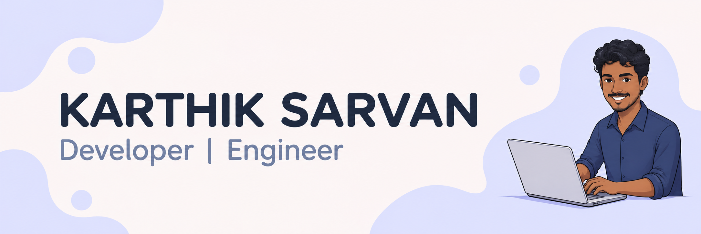

## 💬 Hi, I'm Karthik!

  
&nbsp;

  

    &nbsp;&nbsp;&nbsp;
    &nbsp;&nbsp;&nbsp;
    &nbsp;&nbsp;&nbsp;
    &nbsp;&nbsp;&nbsp;
    &nbsp;&nbsp;&nbsp;
    
  

---

I work at **Aegion Dynamics** and maintain
[Mimic](https://mimic.aegiondynamic.com/), an open-source project.
I mostly write **C** and enjoy building low-level systems and exploring the
Linux kernel, graphics stack, and **Mesa3D**.

### Skills

- **Languages:** C, C++, Python, Shell
- **Embedded:** Embedded systems, ARM-based systems, low-level programming
- **Linux:** Linux kernel, Linux graphics stack, Mesa3D
- **Tools:** Git, GitLab, debugging, build systems
